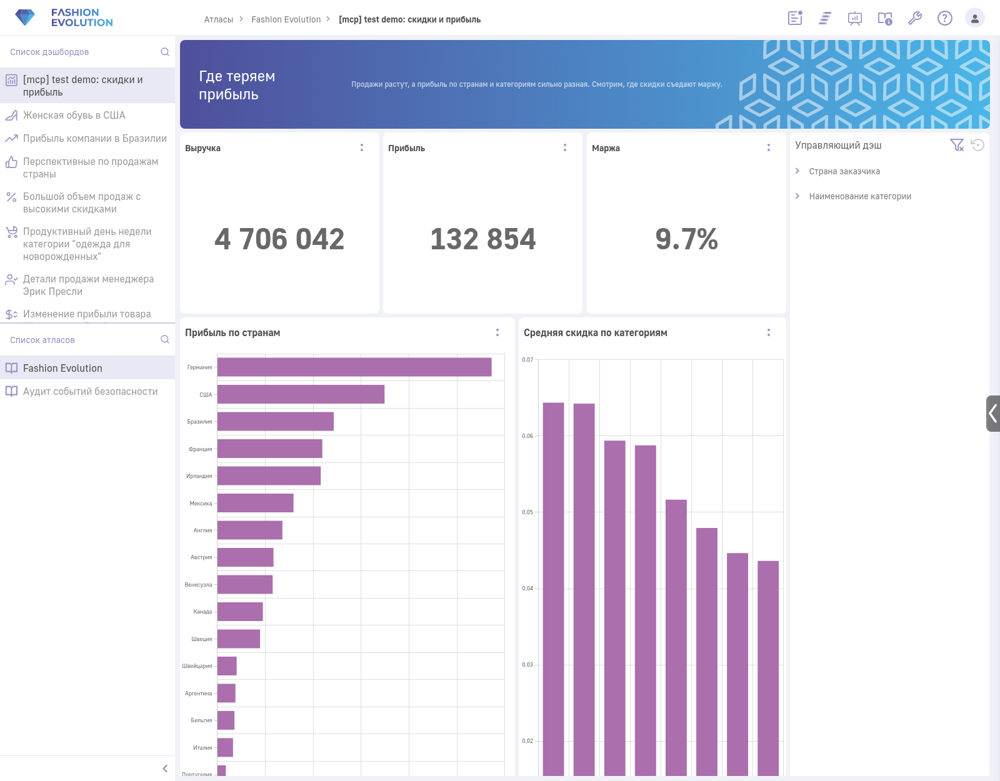
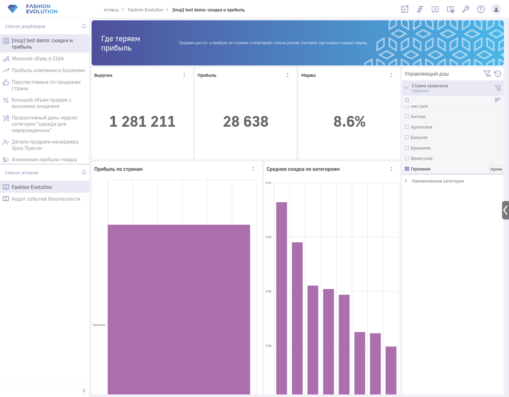

<div align="center">

# 🧭 luxms-mcp

**MCP-сервер для Luxms BI: ИИ-ассистент сам находит кубы, считает данные и собирает дашборды**


-7C3AED)




<sub>Дашборд выше целиком собран ассистентом через этот сервер</sub>

</div>

---

## 📑 Содержание

- [Что это](#-что-это)
- [Возможности](#-возможности)
- [Быстрый старт](#-быстрый-старт)
- [Конфигурация](#%EF%B8%8F-конфигурация)
- [Подключение к клиенту](#-подключение-к-клиенту)
- [Docker](#-docker)
- [Инструменты](#-инструменты)
- [Синтаксис мер](#-синтаксис-мер)
- [Защита от случайных правок](#%EF%B8%8F-защита-от-случайных-правок)
- [Пример сценария](#-пример-сценария)
- [Структура проекта](#-структура-проекта)
- [Тесты](#-тесты)

## 💡 Что это

Сервер даёт языковой модели 20 инструментов для работы с Luxms BI через его API: от разведки
данных («какие есть кубы и по чему их резать») до готового интерактивного дашборда с
фильтрами, KPI и графиками.

Проект сделан для хакатона **«Современная визуальная аналитика на Luxms BI»** (СПбГУ, кейс
e-commerce компании Stellara: возвраты, затоваривание, неэффективные скидки), но работает с
любым стендом Luxms BI.

## ✨ Возможности

| | |
|---|---|
| 🔍 **Разведка** | Атласы, кубы, поля по ролям (измерения, даты с диапазоном, готовые меры) одним вызовом |
| 📊 **Аналитика** | Выборки из куба, Парето-разбивки, сравнение периодов с вкладом в изменение |
| 🧱 **Дашборды** | Создание, фильтры, KPI, 14 типов графиков, заметки, автораскладка по сетке |
| 🛡️ **Безопасность** | Запись выключена по умолчанию, `dry_run`, подтверждение удаления, защита чужих объектов |
| 🇷🇺 **Понятные ошибки** | Ошибки стенда переводятся в подсказки (истекла сессия, лишний `sum()`, нет столбца) |

## 🚀 Быстрый старт

```bash
cp .env.example .env     # заполнить LUXMS_URL и LUXMS_COOKIE (или LUXMS_TOKEN)
uv sync
uv run luxms-mcp         # запуск сервера по stdio
```

> Кука `BI-User-Session` берётся из DevTools браузера (Application → Cookies).
> **Сессия истекает** — перед демо обновите значение.

## ⚙️ Конфигурация

Сервер читает `.env` из корня проекта; переменные окружения имеют приоритет.

| Переменная | По умолчанию | Описание |
|---|---|---|
| `LUXMS_URL` | — (обязательно) | Адрес стенда, например `https://hackathon20.a2c.luxmsbi.ru` |
| `LUXMS_COOKIE` | пусто | Кука сессии: `BI-User-Session=<uuid>` |
| `LUXMS_TOKEN` | пусто | Токен доступа (вместо куки) |
| `LUXMS_USER` / `LUXMS_PASSWORD` | пусто | Логин и пароль — запасной вариант входа |
| `LUXMS_LOGIN_PATH` | `/api/auth/login` | Эндпоинт логина (для варианта с паролем) |
| `LUXMS_READONLY` | `1` | `0` — включить инструменты записи |
| `LUXMS_TIMEOUT` | `30` | Таймаут запросов, секунды |
| `LUXMS_MAX_ROWS` | `200` | Максимум строк в ответе `query_cube` |

## 🔌 Подключение к клиенту

<details open>
<summary><b>Claude Code</b></summary>

```bash
claude mcp add luxms -e LUXMS_READONLY=0 -- uv --directory /path/to/luxms-mcp run luxms-mcp
```
</details>

<details>
<summary><b>Claude Desktop</b> — <code>claude_desktop_config.json</code></summary>

```json
{
  "mcpServers": {
    "luxms": {
      "command": "uv",
      "args": ["--directory", "/path/to/luxms-mcp", "run", "luxms-mcp"],
      "env": { "LUXMS_READONLY": "0" }
    }
  }
}
```
</details>

<details>
<summary><b>Через Docker</b></summary>

```json
{
  "mcpServers": {
    "luxms": {
      "command": "docker",
      "args": ["run", "-i", "--rm", "--env-file", "/path/to/luxms-mcp/.env", "luxms-mcp:latest"]
    }
  }
}
```
</details>

## 🐳 Docker

```bash
docker build -t luxms-mcp .                              # сборка образа
docker run -i --rm --env-file .env luxms-mcp             # запуск (stdio, нужен флаг -i)
docker compose run --rm -T luxms-mcp                     # то же через compose
```

Файл `.env` в образ **не копируется** — настройки передаются при запуске.

## 🧰 Инструменты

### 🔍 Разведка

| Инструмент | Что делает |
|---|---|
| `ping` | Адрес стенда, способ авторизации, включена ли запись |
| `list_atlases` | Список атласов (с поиском) |
| `list_cubes` | Кубы атласа; поле `cube` (`источник.имя`) подставляется в остальные инструменты |
| `cube_overview` | Карта куба за один вызов: измерения, даты с диапазоном, готовые выражения мер |
| `describe_cube` | Все поля куба (с поиском) |

### 📊 Анализ

| Инструмент | Что делает |
|---|---|
| `query_cube` | Выборка данных из куба (лимит `LUXMS_MAX_ROWS`) |
| `breakdown` | Топ-N по измерению с долей и накопленной долей — **Парето** |
| `compare_periods` | Период А против Б (всего или по измерению), сортировка по **вкладу в изменение** |
| `explain_query` | SQL, который Luxms выполнит для запроса |
| `count_rows` | Количество строк запроса |

### 📋 Дашборды — чтение

| Инструмент | Что делает |
|---|---|
| `list_dashboards` | Дашборды атласа |
| `get_dashboard` | Дашборд со всеми дашлетами (`raw_config` — сырой конфиг) |

### 🧱 Дашборды — запись

> Доступны только при `LUXMS_READONLY=0`. У всех `dry_run=true` по умолчанию.

| Инструмент | Что делает |
|---|---|
| `create_dashboard` | Создаёт пустой дашборд, возвращает id и ссылку |
| `add_filter_panel` | Панель фильтров по измерениям. **Добавлять до графиков** |
| `add_kpi` | KPI-плитка с одной мерой (`as_percent=true` для долей) |
| `add_chart` | График: `bar`, `column`, `line`, `area`, `spline`, `stacked`, `table`, `waterfall`, `funnel`, `treemap`, `gauge`, `radar`, `heatmap`, `pie` |
| `add_note` | Заголовок / текст: вывод, рекомендация, введение |
| `update_dashlet` | Частичное изменение дашлета (заголовок, тип, конфиг) |
| `delete_dashlet` | Удаление дашлета (`dry_run=false` + `confirm=true`) |
| `delete_dashboard` | Удаление дашборда с дашлетами (`dry_run=false` + `confirm=true`) |

Без `x`/`y` блоки сами встают в первое свободное место сетки 12×N. Графики и KPI,
добавленные после панели фильтров, автоматически реагируют на её поля.

## 🧮 Синтаксис мер

| Запись | Смысл |
|---|---|
| `profit` | Готовая формула куба — как есть |
| `sum(sales)` | Поле через агрегат |
| `avg(discount)`, `count(orderid)` | Любой другой агрегат |
| `sum(sales):revenue` | `выражение:алиас` — переименование меры |

## 🛡️ Защита от случайных правок

- 🔒 Запись **выключена** по умолчанию (`LUXMS_READONLY=1`).
- 👀 Все пишущие инструменты стартуют с `dry_run=true` — сначала показывают запрос.
- ✋ Удаление только с `confirm=true`.
- 🏷️ Свои объекты помечаются флагом `_mcp` в конфиге; чужие дашборды и дашлеты без `force=true` не меняются.
- 🚫 Пишущие запросы не повторяются автоматически и фиксируются в `luxms-mcp.log`.

## 🎬 Пример сценария

1. `list_atlases` → `list_cubes` → `cube_overview` — понять, какие данные есть.
2. `breakdown` по категориям и `compare_periods` до/после — найти, где теряются деньги.
3. `create_dashboard` → `add_filter_panel` → `add_kpi` / `add_chart` / `add_note` — собрать вывод в дашборд.

Дашборд с применённым фильтром «Германия»:



## 🗂️ Структура проекта

```
luxms-mcp/
├── src/luxms_mcp/
│   ├── server.py           # FastMCP-сервер, регистрация инструментов
│   ├── config.py           # загрузка .env и настроек
│   ├── client.py           # HTTP-клиент Luxms BI
│   ├── tools_read.py       # атласы, кубы, дашборды (чтение)
│   ├── tools_analytics.py  # cube_overview, breakdown, compare_periods
│   └── tools_write.py      # создание и правка дашбордов
├── tests/
│   ├── test_offline.py     # офлайн-тесты без сети
│   ├── e2e_mcp.py          # полный сценарий через MCP-клиент
│   ├── demo_scenario.py    # демо: разведка → гипотезы → дашборд
│   ├── write_probe.py      # проверка сырых запросов записи
│   └── smoke_test.py
├── docs/                   # скриншоты
├── Dockerfile
├── docker-compose.yml
└── pyproject.toml
```

## 🧪 Тесты

```bash
uv run pytest tests/test_offline.py     # офлайн, без сети
uv run python tests/e2e_mcp.py          # CRUD через MCP; создаёт и удаляет "[mcp] test e2e"
uv run python tests/demo_scenario.py    # сценарий демо (--keep оставит дашборд)
```

Все пути чтения и записи проверены на стенде: POST — создание, PUT `.filter(id=N)` с
частичным телом — изменение, DELETE `.filter(id=N)` — удаление.
